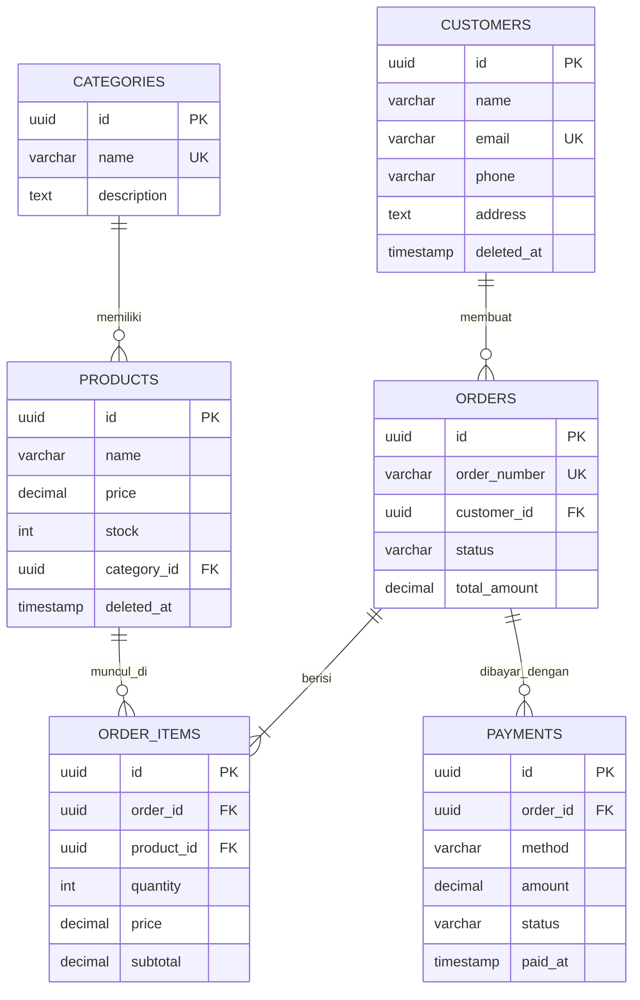

# API Specification - Toko Online

Backend untuk aplikasi pengelolaan toko online yang mencakup produk, kategori, pelanggan, pesanan, dan detail pesanan. Dibangun dengan NestJS, TypeScript, TypeORM, dan PostgreSQL.

## Daftar Isi

1. [Informasi Umum](#1-informasi-umum)
2. [Model Data dan Relasi](#2-model-data-dan-relasi)
3. [Autentikasi](#3-autentikasi)
4. [Categories](#4-categories)
5. [Customers](#5-customers)
6. [Products dan Stok](#6-products-dan-stok)
7. [Orders](#7-orders)
8. [Order Items](#8-order-items)
9. [Payments](#9-payments)
10. [Ringkasan Seluruh Endpoint](#10-ringkasan-seluruh-endpoint)
11. [Batasan yang Diketahui](#11-batasan-yang-diketahui)

---

## 1. Informasi Umum

| Item | Nilai |
|---|---|
| Base URL | `http://localhost:3000` |
| Format data | JSON (`Content-Type: application/json`) |
| Autentikasi | JWT Bearer Token (lihat bagian 3) |
| Primary key | UUID versi 4 |

### Konvensi

- Semua `id` berupa UUID, contoh `3f2a8c1e-5b7d-4e9a-9c3b-1a2b3c4d5e6f`.
- Nilai uang (`price`, `subtotal`, `totalAmount`, `amount`) dikembalikan sebagai **string desimal**, contoh `"150000.00"`. Ini perilaku PostgreSQL untuk tipe `decimal`. Saat mengirim data, kirim sebagai angka (`150000`).
- Waktu memakai format ISO 8601 (`2026-11-09T10:00:00.000Z`).
- Field di luar yang didefinisikan pada request body **ditolak** dengan status `400` (`whitelist` aktif).

### Header yang dipakai

| Header | Nilai | Keterangan |
|---|---|---|
| `Content-Type` | `application/json` | Wajib untuk request yang memiliki body |
| `Authorization` | `Bearer <accessToken>` | Wajib untuk semua endpoint kecuali `register` dan `login` |

### Format Error

Semua error memiliki bentuk yang sama.

```json
{
  "message": "Pelanggan tidak ditemukan",
  "error": "Not Found",
  "statusCode": 404
}
```

Untuk kegagalan validasi, `message` berupa **array** berisi semua pelanggaran:

```json
{
  "message": [
    "Nama harus diisi",
    "Format email tidak valid"
  ],
  "error": "Bad Request",
  "statusCode": 400
}
```

### Status Code yang Digunakan

| Kode | Arti | Contoh penyebab |
|---|---|---|
| `200` | OK | Data berhasil diambil, diubah, atau dihapus |
| `201` | Created | Data berhasil dibuat (`POST`) |
| `400` | Bad Request | Validasi gagal, stok tidak cukup, atau aturan bisnis dilanggar |
| `401` | Unauthorized | Token tidak ada, tidak valid, atau kedaluwarsa. Atau email/password salah saat login |
| `404` | Not Found | Data dengan `id` tersebut tidak ada |
| `409` | Conflict | Data bentrok dengan yang sudah ada, misalnya email sudah terdaftar |
| `500` | Internal Server Error | Kesalahan tak terduga di server |

---

## 2. Model Data dan Relasi

### Tabel

| Tabel | Kolom |
|---|---|
| `categories` | `id`, `name` (unik), `description`, `created_at`, `updated_at` |
| `products` | `id`, `name`, `description`, `price`, `stock`, `category_id` (FK), `created_at`, `updated_at`, `deleted_at` |
| `customers` | `id`, `name`, `email` (unik), `phone`, `address`, `created_at`, `updated_at`, `deleted_at` |
| `orders` | `id`, `order_number` (unik), `customer_id` (FK), `status`, `total_amount`, `created_at`, `updated_at` |
| `order_items` | `id`, `order_id` (FK), `product_id` (FK), `quantity`, `price`, `subtotal` |
| `payments` | `id`, `order_id` (FK), `method`, `amount`, `status`, `paid_at`, `created_at`, `updated_at` |
| `users` | `id`, `name`, `email` (unik), `password` (hash bcrypt), `created_at` |

Kolom `deleted_at` menandakan **soft delete**: data tidak dihapus dari database, hanya ditandai sehingga tidak muncul lagi di daftar.

### Relasi

| Parent | Child | Jenis | Aturan hapus |
|---|---|---|---|
| `categories` | `products` | One-to-Many | `SET NULL` |
| `customers` | `orders` | One-to-Many | `RESTRICT` |
| `orders` | `order_items` | One-to-Many | `CASCADE` |
| `products` | `order_items` | One-to-Many | `RESTRICT` |
| `orders` | `payments` | One-to-Many | `CASCADE` |

Hubungan `orders` dan `products` bersifat banyak-ke-banyak, dan dipecah lewat tabel penghubung `order_items` yang menyimpan `quantity`, `price`, dan `subtotal`.

### ERD



---

## 3. Autentikasi

Semua endpoint memerlukan header `Authorization: Bearer <accessToken>`, **kecuali** `POST /auth/register` dan `POST /auth/login`. Tanpa token yang valid, server menjawab `401`.

### POST /auth/register

Mendaftarkan akun baru. Password disimpan dalam bentuk hash bcrypt.

**Request body**

| Field | Tipe | Wajib | Aturan |
|---|---|---|---|
| `name` | string | ya | maksimal 150 karakter |
| `email` | string | ya | format email valid, unik |
| `password` | string | ya | minimal 6 karakter |

```json
{
  "name": "Fatim",
  "email": "fatim@mail.com",
  "password": "123456"
}
```

**Response `201 Created`** (password tidak ikut dikembalikan)

```json
{
  "id": "0b7c5f3e-2d41-4c8a-a1f6-9e3d7b2c4a10",
  "name": "Fatim",
  "email": "fatim@mail.com"
}
```

| Status | Penyebab | Pesan |
|---|---|---|
| `400` | Validasi gagal | `Format email tidak valid`, `Password harus minimal 6 karakter`, dst. |
| `409` | Email sudah dipakai | `Email sudah terdaftar, gunakan email lain` |

### POST /auth/login

Masuk dan mendapatkan token JWT.

**Request body**

| Field | Tipe | Wajib | Aturan |
|---|---|---|---|
| `email` | string | ya | format email valid |
| `password` | string | ya | - |

```json
{
  "email": "fatim@mail.com",
  "password": "123456"
}
```

**Response `200 OK`**

```json
{
  "accessToken": "eyJhbGciOiJIUzI1NiIsInR5cCI6IkpXVCJ9...",
  "user": {
    "id": "0b7c5f3e-2d41-4c8a-a1f6-9e3d7b2c4a10",
    "name": "Fatim",
    "email": "fatim@mail.com"
  }
}
```

| Status | Penyebab | Pesan |
|---|---|---|
| `400` | Validasi gagal | `Email harus diisi`, dst. |
| `401` | Email atau password salah | `Email atau password salah` |

Pesan error sengaja dibuat sama untuk email salah maupun password salah, supaya tidak bisa dipakai menebak email yang terdaftar.

### Error autentikasi pada endpoint lain

| Status | Penyebab | Pesan |
|---|---|---|
| `401` | Header `Authorization` tidak ada | `Token tidak ditemukan, silakan login` |
| `401` | Token salah atau kedaluwarsa | `Token tidak valid atau sudah kedaluwarsa` |

---

## 4. Categories

Mengelola kategori produk. Satu kategori dapat memiliki banyak produk.

### POST /categories

Membuat kategori baru.

| Field | Tipe | Wajib | Aturan |
|---|---|---|---|
| `name` | string | ya | maksimal 100 karakter, unik |
| `description` | string | tidak | - |

```json
{
  "name": "Elektronik",
  "description": "Perangkat elektronik"
}
```

**Response `201 Created`**

```json
{
  "id": "3f2a8c1e-5b7d-4e9a-9c3b-1a2b3c4d5e6f",
  "name": "Elektronik",
  "description": "Perangkat elektronik",
  "createdAt": "2026-11-09T10:00:00.000Z",
  "updatedAt": "2026-11-09T10:00:00.000Z"
}
```

| Status | Penyebab | Pesan |
|---|---|---|
| `400` | Validasi gagal | `Nama kategori harus diisi`, `Nama kategori maksimal 100 karakter` |
| `409` | Nama sudah dipakai | `Nama kategori sudah digunakan` |

### GET /categories

Menampilkan semua kategori, diurutkan dari yang terbaru. **Response `200`**: array kategori.

### GET /categories/:id

Menampilkan satu kategori **beserta daftar produknya** (`products`).

| Parameter | Lokasi | Tipe | Keterangan |
|---|---|---|---|
| `id` | path | UUID | ID kategori |

| Status | Penyebab | Pesan |
|---|---|---|
| `200` | Berhasil | - |
| `404` | ID tidak ditemukan | `Kategori tidak ditemukan` |

### PUT /categories/:id

Mengubah kategori. Body sama dengan `POST /categories`. **Response `200`**: kategori yang sudah diubah.

| Status | Penyebab |
|---|---|
| `400` | Validasi gagal |
| `404` | `Kategori tidak ditemukan` |
| `409` | Nama sudah dipakai kategori lain |

### DELETE /categories/:id

Menghapus kategori. Produk yang memakai kategori ini tidak ikut terhapus, `category_id`-nya menjadi `null`.

**Response `200`**

```json
{
  "message": "Kategori berhasil dihapus",
  "deletedId": "3f2a8c1e-5b7d-4e9a-9c3b-1a2b3c4d5e6f"
}
```

| Status | Penyebab |
|---|---|
| `404` | `Kategori tidak ditemukan` |

---

## 5. Customers

Mengelola data pelanggan. Satu pelanggan dapat memiliki banyak pesanan. Penghapusan bersifat **soft delete**.

### POST /customers

| Field | Tipe | Wajib | Aturan |
|---|---|---|---|
| `name` | string | ya | maksimal 150 karakter |
| `email` | string | ya | format email valid, unik di antara pelanggan aktif |
| `phone` | string | ya | 10 sampai 20 karakter, hanya angka dan `+` |
| `address` | string | tidak | - |

```json
{
  "name": "Cruella",
  "email": "cruella@gmail.com",
  "phone": "081234567890",
  "address": "Jakarta"
}
```

**Response `201 Created`**

```json
{
  "id": "a1b2c3d4-1111-4222-8333-444455556666",
  "name": "Cruella",
  "email": "cruella@gmail.com",
  "phone": "081234567890",
  "address": "Jakarta",
  "createdAt": "2026-11-09T10:05:00.000Z",
  "updatedAt": "2026-11-09T10:05:00.000Z",
  "deletedAt": null
}
```

| Status | Penyebab | Pesan |
|---|---|---|
| `400` | Validasi gagal | `Nama harus diisi`, `Format email tidak valid`, `Nomor telepon tidak valid` |
| `409` | Email sudah dipakai | `Email sudah terdaftar, gunakan email lain` |

### GET /customers

Menampilkan semua pelanggan aktif. **Response `200`**: array pelanggan.

### GET /customers/:id

Menampilkan satu pelanggan. Error: `404` `Pelanggan tidak ditemukan`.

### GET /customers/:id/orders

Menampilkan pelanggan **beserta semua pesanannya** (`orders`), diurutkan dari yang terbaru. Membuktikan relasi satu pelanggan memiliki banyak pesanan.

**Response `200`**

```json
{
  "id": "a1b2c3d4-1111-4222-8333-444455556666",
  "name": "Cruella",
  "email": "cruella@gmail.com",
  "orders": [
    {
      "id": "c41cecbe-5397-4cdb-b100-b1b7193b91be",
      "orderNumber": "ORD-20261109-4821",
      "status": "paid",
      "totalAmount": "300000.00"
    }
  ]
}
```

Pelanggan yang belum punya pesanan menghasilkan `"orders": []`. Error: `404` `Pelanggan tidak ditemukan`.

### PUT /customers/:id

Mengubah pelanggan. Body sama dengan `POST /customers` (semua field wajib dikirim ulang). Error: `400`, `404`, `409`.

### DELETE /customers/:id

Soft delete: pelanggan tidak muncul lagi di daftar, tetapi riwayat pesanannya tetap utuh. Email pelanggan yang sudah dihapus boleh didaftarkan ulang.

**Response `200`**

```json
{
  "message": "Pelanggan berhasil dihapus",
  "deletedId": "a1b2c3d4-1111-4222-8333-444455556666"
}
```

---

## 6. Products dan Stok

Mengelola produk. Setiap produk terhubung ke satu kategori. Penghapusan bersifat **soft delete**.

### POST /products

| Field | Tipe | Wajib | Aturan |
|---|---|---|---|
| `name` | string | ya | maksimal 150 karakter |
| `description` | string | tidak | - |
| `price` | number | ya | tidak boleh negatif |
| `stock` | integer | ya | bilangan bulat, tidak boleh negatif |
| `categoryId` | UUID | ya | harus ID kategori yang ada |

```json
{
  "name": "Mouse",
  "description": "Mouse wireless",
  "price": 150000,
  "stock": 5,
  "categoryId": "3f2a8c1e-5b7d-4e9a-9c3b-1a2b3c4d5e6f"
}
```

**Response `201 Created`**

```json
{
  "id": "da9ba864-a36f-4a9c-bc74-3a5e65079aab",
  "name": "Mouse",
  "description": "Mouse wireless",
  "price": "150000.00",
  "stock": 5,
  "categoryId": "3f2a8c1e-5b7d-4e9a-9c3b-1a2b3c4d5e6f",
  "createdAt": "2026-11-09T10:10:00.000Z",
  "updatedAt": "2026-11-09T10:10:00.000Z",
  "deletedAt": null
}
```

| Status | Penyebab | Pesan |
|---|---|---|
| `400` | Validasi gagal | `Nama produk harus diisi`, `Harga tidak boleh negatif`, `ID kategori tidak valid`, dst. |
| `404` | Kategori tidak ada | `Kategori tidak ditemukan` |

### GET /products

Menampilkan semua produk beserta kategorinya (`category`), diurutkan dari yang terbaru.

### GET /products/:id

Menampilkan satu produk beserta kategorinya. Error: `404` `Produk tidak ditemukan`.

### PUT /products/:id

Mengubah produk. Body sama dengan `POST /products` dan **semua field wajib dikirim ulang**. Nilai `stock` yang dikirim **menimpa** stok lama. Untuk menambah atau mengurangi stok, gunakan `PATCH /products/:id/stock`.

Error: `400`, `404` (`Produk tidak ditemukan` atau `Kategori tidak ditemukan`).

### DELETE /products/:id

Soft delete. Produk tidak muncul lagi di daftar, namun item pesanan lama tetap merujuk ke produk ini. **Response `200`**: `{ "message": "Produk berhasil dihapus", "deletedId": "..." }`.

### Manajemen Stok

> Rute `GET /products/stock` harus didefinisikan **sebelum** `GET /products/:id` di controller, kalau tidak kata `stock` terbaca sebagai `id`.

#### GET /products/stock

Menampilkan stok semua produk, diurutkan berdasarkan nama.

| Query | Tipe | Keterangan |
|---|---|---|
| `available` | `true` | Opsional. Jika `true`, hanya produk dengan stok lebih dari 0 |

**Response `200`**

```json
[
  { "id": "da9ba864-a36f-4a9c-bc74-3a5e65079aab", "name": "Mouse", "stock": 10, "isAvailable": true },
  { "id": "7c1e2d3f-aaaa-4bbb-8ccc-ddddeeeeffff", "name": "Keyboard", "stock": 0, "isAvailable": false }
]
```

#### GET /products/:id/stock

Menampilkan stok satu produk.

```json
{
  "id": "da9ba864-a36f-4a9c-bc74-3a5e65079aab",
  "name": "Mouse",
  "stock": 10,
  "isAvailable": true
}
```

Error: `404` `Produk tidak ditemukan`.

#### PATCH /products/:id/stock

Menyesuaikan stok secara manual (restock atau koreksi). Nilai berupa **selisih**, bukan stok akhir.

| Field | Tipe | Wajib | Aturan |
|---|---|---|---|
| `adjustment` | integer | ya | positif menambah, negatif mengurangi |

```json
{ "adjustment": 5 }
```

**Response `200`**: bentuk sama dengan `GET /products/:id/stock`.

| Status | Penyebab | Pesan |
|---|---|---|
| `400` | Bukan bilangan bulat | `Jumlah penyesuaian harus berupa bilangan bulat` |
| `400` | Hasil akhir negatif | `Stok tidak boleh negatif (stok saat ini 10)` |
| `404` | Produk tidak ada | `Produk tidak ditemukan` |

#### Perubahan stok otomatis oleh pesanan

| Kejadian | Efek pada stok |
|---|---|
| Pesanan dibuat | Berkurang sesuai `quantity` |
| Pesanan dibatalkan (`cancelled`) | Dikembalikan |
| Pesanan `pending` dihapus | Dikembalikan |
| Item ditambah atau jumlahnya naik | Berkurang sesuai selisih |
| Item dihapus atau jumlahnya turun | Dikembalikan sesuai selisih |

Pemesanan produk dengan stok 0 menghasilkan `400` `Stok <nama produk> habis`. Pemesanan melebihi stok menghasilkan `400` `Stok <nama produk> tidak cukup (tersisa N)`.

---

## 7. Orders

Mengelola pesanan. Satu pesanan memiliki banyak item (`items`). Pembuatan pesanan berjalan dalam **satu transaksi database**: jika satu langkah gagal, semua perubahan (stok, pesanan, item) dibatalkan.

### Aturan bisnis

1. Pelanggan harus ada.
2. Setiap produk harus ada dan stoknya cukup.
3. Harga diambil dari produk **saat transaksi** dan disimpan di item sebagai snapshot. `subtotal` dan `totalAmount` dihitung oleh server. Client **tidak boleh** mengirim harga atau total.
4. Produk yang sama yang dikirim dua kali digabung menjadi satu item.
5. Nomor pesanan dibuat otomatis dengan format `ORD-YYYYMMDD-XXXX`.
6. Status awal selalu `pending`.

### POST /orders

Membuat pesanan beserta item-itemnya.

| Field | Tipe | Wajib | Aturan |
|---|---|---|---|
| `customerId` | UUID | ya | harus ID pelanggan yang ada |
| `items` | array | ya | minimal 1 item |
| `items[].productId` | UUID | ya | harus ID produk yang ada |
| `items[].quantity` | integer | ya | minimal 1 |

```json
{
  "customerId": "a1b2c3d4-1111-4222-8333-444455556666",
  "items": [
    { "productId": "da9ba864-a36f-4a9c-bc74-3a5e65079aab", "quantity": 2 },
    { "productId": "7c1e2d3f-aaaa-4bbb-8ccc-ddddeeeeffff", "quantity": 1 }
  ]
}
```

**Response `201 Created`**

```json
{
  "id": "c41cecbe-5397-4cdb-b100-b1b7193b91be",
  "orderNumber": "ORD-20261109-4821",
  "customerId": "a1b2c3d4-1111-4222-8333-444455556666",
  "status": "pending",
  "totalAmount": "400000.00",
  "customer": { "id": "a1b2c3d4-1111-4222-8333-444455556666", "name": "Cruella" },
  "items": [
    {
      "id": "e5f6a7b8-0001-4000-8000-000000000001",
      "productId": "da9ba864-a36f-4a9c-bc74-3a5e65079aab",
      "quantity": 2,
      "price": "150000.00",
      "subtotal": "300000.00",
      "product": { "id": "da9ba864-a36f-4a9c-bc74-3a5e65079aab", "name": "Mouse" }
    },
    {
      "id": "e5f6a7b8-0002-4000-8000-000000000002",
      "productId": "7c1e2d3f-aaaa-4bbb-8ccc-ddddeeeeffff",
      "quantity": 1,
      "price": "100000.00",
      "subtotal": "100000.00",
      "product": { "id": "7c1e2d3f-aaaa-4bbb-8ccc-ddddeeeeffff", "name": "Keyboard" }
    }
  ],
  "createdAt": "2026-11-09T10:20:00.000Z",
  "updatedAt": "2026-11-09T10:20:00.000Z"
}
```

| Status | Penyebab | Pesan |
|---|---|---|
| `400` | Body tidak sesuai | `ID pelanggan harus diisi`, `Pesanan minimal berisi 1 item`, `Jumlah minimal 1`, `property item should not exist` |
| `400` | Stok habis | `Stok Mouse habis` |
| `400` | Stok kurang | `Stok Mouse tidak cukup (tersisa 3)` |
| `404` | Pelanggan tidak ada | `Pelanggan tidak ditemukan` |
| `404` | Produk tidak ada | `Produk <id> tidak ditemukan` |

### GET /orders

Menampilkan semua pesanan beserta data pelanggan (`customer`), diurutkan dari yang terbaru.

### GET /orders/:id

Menampilkan **detail pesanan beserta informasi produk terkait**: data `customer`, daftar `items`, dan data `product` pada tiap item. Jika pembayaran sudah dibuat, `payments` ikut ditampilkan (bila relasinya dimuat di service).

Error: `404` `Pesanan tidak ditemukan`.

### PATCH /orders/:id/status

Mengubah status pesanan.

| Field | Tipe | Wajib | Nilai yang diterima |
|---|---|---|---|
| `status` | string | ya | `pending`, `paid`, `shipped`, `completed`, `cancelled` |

```json
{ "status": "shipped" }
```

**Aturan perubahan status**

| Kondisi | Hasil |
|---|---|
| Pesanan `cancelled` | Tidak bisa diubah (`400`) |
| Pesanan `completed` | Tidak bisa diubah (`400`) |
| Pesanan `shipped` dibatalkan | Ditolak (`400`) |
| Status menjadi `cancelled` | Stok setiap item **dikembalikan**, dalam satu transaksi |

Alur yang dirancang: `pending → paid → shipped → completed`, dengan jalur pembatalan ke `cancelled`. Status `paid` seharusnya dicapai melalui pembayaran (lihat bagian 9).

**Response `200`**: detail pesanan dengan status terbaru.

| Status | Penyebab | Pesan |
|---|---|---|
| `400` | Nilai status tidak dikenal | `Status tidak valid` |
| `400` | Pesanan `cancelled` | `Pesanan yang sudah dibatalkan tidak dapat diubah` |
| `400` | Pesanan `completed` | `Pesanan yang sudah selesai tidak dapat diubah` |
| `400` | Pesanan `shipped` dibatalkan | `Pesanan yang sudah dikirim tidak dapat dibatalkan` |
| `404` | Pesanan tidak ada | `Pesanan tidak ditemukan` |

### DELETE /orders/:id

Menghapus pesanan. Hanya pesanan berstatus `pending` atau `cancelled` yang boleh dihapus. Jika `pending`, stok dikembalikan terlebih dahulu.

**Response `200`**

```json
{
  "message": "Pesanan berhasil dihapus",
  "deletedId": "c41cecbe-5397-4cdb-b100-b1b7193b91be"
}
```

| Status | Penyebab | Pesan |
|---|---|---|
| `400` | Status bukan `pending` atau `cancelled` | `Hanya pesanan berstatus pending atau cancelled yang dapat dihapus` |
| `404` | Pesanan tidak ada | `Pesanan tidak ditemukan` |

---

## 8. Order Items

Mengelola detail item pada pesanan. Satu produk dapat muncul di banyak item (pada pesanan berbeda).

### Aturan bisnis

1. Item hanya dapat ditambah, diubah, atau dihapus selama pesanan berstatus **`pending`**.
2. Harga item adalah snapshot saat item pertama dibuat dan **tidak berubah** walau harga produk berubah.
3. Menambah produk yang sudah ada di pesanan menjumlahkan `quantity`, tidak membuat baris ganda.
4. `totalAmount` pesanan dihitung ulang otomatis setiap ada perubahan, dan stok produk menyesuaikan.
5. Semua perubahan berjalan dalam satu transaksi.

### GET /order-items

Menampilkan item beserta data produk dan pesanan, dengan filter opsional.

| Query | Tipe | Keterangan |
|---|---|---|
| `orderId` | UUID | Hanya item milik pesanan tersebut |
| `productId` | UUID | Hanya item yang memuat produk tersebut (membuktikan satu produk muncul di banyak pesanan) |

Contoh: `GET /order-items?productId=da9ba864-a36f-4a9c-bc74-3a5e65079aab`

### GET /order-items/:id

Menampilkan satu item beserta `product` dan `order`. Error: `404` `Item pesanan tidak ditemukan`.

### POST /order-items

Menambah item ke pesanan `pending`.

| Field | Tipe | Wajib | Aturan |
|---|---|---|---|
| `orderId` | UUID | ya | pesanan harus berstatus `pending` |
| `productId` | UUID | ya | harus ID produk yang ada |
| `quantity` | integer | ya | minimal 1 |

```json
{
  "orderId": "c41cecbe-5397-4cdb-b100-b1b7193b91be",
  "productId": "da9ba864-a36f-4a9c-bc74-3a5e65079aab",
  "quantity": 1
}
```

**Response `201 Created`**: item beserta data produknya.

| Status | Penyebab | Pesan |
|---|---|---|
| `400` | Validasi gagal | `Jumlah minimal 1`, `ID produk tidak valid`, dst. |
| `400` | Pesanan bukan `pending` | `Item hanya dapat diubah pada pesanan berstatus pending` |
| `400` | Stok habis atau kurang | `Stok <nama> habis` / `Stok <nama> tidak cukup (tersisa N)` |
| `404` | Pesanan tidak ada | `Pesanan tidak ditemukan` |
| `404` | Produk tidak ada | `Produk tidak ditemukan` |

### PUT /order-items/:id

Mengubah jumlah item.

| Field | Tipe | Wajib | Aturan |
|---|---|---|---|
| `quantity` | integer | ya | minimal 1 |

```json
{ "quantity": 3 }
```

Selisih jumlah menyesuaikan stok: kenaikan mengurangi stok, penurunan mengembalikan stok. **Response `200`**: item terbaru.

Error: `400` (validasi, pesanan bukan `pending`, stok tidak cukup), `404` `Item pesanan tidak ditemukan`.

### DELETE /order-items/:id

Menghapus item dari pesanan `pending`. Stok dikembalikan dan total pesanan dihitung ulang.

**Response `200`**

```json
{
  "message": "Item pesanan berhasil dihapus",
  "deletedId": "e5f6a7b8-0002-4000-8000-000000000002"
}
```

Error: `400` pesanan bukan `pending`, `404` `Item pesanan tidak ditemukan`.

---

## 9. Payments

Mencatat informasi pembayaran dari pelanggan: metode, status, dan tanggal pembayaran.

### Aturan bisnis

1. Pembayaran hanya dapat dibuat untuk pesanan berstatus `pending`.
2. `amount` diambil dari `totalAmount` pesanan oleh server, bukan dari client.
3. Satu pesanan hanya boleh memiliki **satu pembayaran aktif** (`unpaid` atau `paid`). Jika pembayaran sebelumnya `failed`, boleh dibuat percobaan baru.
4. Pembayaran baru selalu berstatus `unpaid`. Status dapat diubah ke `paid` atau `failed`, lalu tidak dapat diubah lagi.
5. Saat menjadi `paid`, `paidAt` terisi otomatis dan status pesanan ikut menjadi `paid`, dalam satu transaksi.

### POST /payments

| Field | Tipe | Wajib | Nilai yang diterima |
|---|---|---|---|
| `orderId` | UUID | ya | ID pesanan yang ada |
| `method` | string | ya | `transfer`, `cod`, `e_wallet`, `credit_card` |

```json
{
  "orderId": "c41cecbe-5397-4cdb-b100-b1b7193b91be",
  "method": "transfer"
}
```

**Response `201 Created`**

```json
{
  "id": "f0a1b2c3-1234-4abc-8def-0123456789ab",
  "orderId": "c41cecbe-5397-4cdb-b100-b1b7193b91be",
  "method": "transfer",
  "amount": "400000.00",
  "status": "unpaid",
  "paidAt": null,
  "createdAt": "2026-11-09T10:30:00.000Z",
  "updatedAt": "2026-11-09T10:30:00.000Z"
}
```

| Status | Penyebab | Pesan |
|---|---|---|
| `400` | Validasi gagal | `Metode pembayaran tidak valid`, `ID pesanan tidak valid` |
| `400` | Pesanan bukan `pending` | `Pembayaran hanya dapat dibuat untuk pesanan berstatus pending` |
| `404` | Pesanan tidak ada | `Pesanan tidak ditemukan` |
| `409` | Sudah ada pembayaran aktif | `Pesanan ini sudah memiliki pembayaran yang aktif` |

### GET /payments

Menampilkan semua pembayaran beserta pesanannya, diurutkan dari yang terbaru.

| Query | Tipe | Keterangan |
|---|---|---|
| `orderId` | UUID | Opsional. Hanya pembayaran milik pesanan tersebut |

### GET /payments/:id

Menampilkan satu pembayaran. Error: `404` `Pembayaran tidak ditemukan`.

### PATCH /payments/:id/status

Mengubah status pembayaran.

| Field | Tipe | Wajib | Nilai yang diterima |
|---|---|---|---|
| `status` | string | ya | `paid` atau `failed` |

```json
{ "status": "paid" }
```

**Response `200`** (contoh saat `paid`)

```json
{
  "id": "f0a1b2c3-1234-4abc-8def-0123456789ab",
  "orderId": "c41cecbe-5397-4cdb-b100-b1b7193b91be",
  "method": "transfer",
  "amount": "400000.00",
  "status": "paid",
  "paidAt": "2026-11-09T10:35:00.000Z"
}
```

| Status | Penyebab | Pesan |
|---|---|---|
| `400` | Nilai tidak valid | `Status harus paid atau failed` |
| `400` | Pembayaran sudah `paid`/`failed` | `Pembayaran berstatus paid tidak dapat diubah` |
| `400` | Pesanan tidak lagi `pending` | `Pesanan tidak lagi berstatus pending, pembayaran tidak dapat dilunasi` |
| `404` | Pembayaran tidak ada | `Pembayaran tidak ditemukan` |

### DELETE /payments/:id

Menghapus pembayaran. Pembayaran yang sudah `paid` tidak boleh dihapus karena merupakan catatan keuangan.

| Status | Penyebab | Pesan |
|---|---|---|
| `200` | Berhasil | `Pembayaran berhasil dihapus` |
| `400` | Status `paid` | `Pembayaran yang sudah paid tidak dapat dihapus` |
| `404` | Pembayaran tidak ada | `Pembayaran tidak ditemukan` |

---

## 10. Ringkasan Seluruh Endpoint

| Resource | Method | Endpoint | Keterangan |
|---|---|---|---|
| Auth | POST | `/auth/register` | Daftar akun (publik) |
| Auth | POST | `/auth/login` | Login, mendapat token (publik) |
| Categories | POST | `/categories` | Buat kategori |
| Categories | GET | `/categories` | Daftar kategori |
| Categories | GET | `/categories/:id` | Detail kategori beserta produk |
| Categories | PUT | `/categories/:id` | Ubah kategori |
| Categories | DELETE | `/categories/:id` | Hapus kategori |
| Customers | POST | `/customers` | Buat pelanggan |
| Customers | GET | `/customers` | Daftar pelanggan |
| Customers | GET | `/customers/:id` | Detail pelanggan |
| Customers | GET | `/customers/:id/orders` | Pelanggan beserta pesanannya |
| Customers | PUT | `/customers/:id` | Ubah pelanggan |
| Customers | DELETE | `/customers/:id` | Hapus pelanggan (soft delete) |
| Products | POST | `/products` | Buat produk |
| Products | GET | `/products` | Daftar produk |
| Products | GET | `/products/stock` | Daftar stok (`?available=true`) |
| Products | GET | `/products/:id` | Detail produk |
| Products | GET | `/products/:id/stock` | Stok satu produk |
| Products | PUT | `/products/:id` | Ubah produk |
| Products | PATCH | `/products/:id/stock` | Tambah atau kurangi stok |
| Products | DELETE | `/products/:id` | Hapus produk (soft delete) |
| Orders | POST | `/orders` | Buat pesanan beserta item |
| Orders | GET | `/orders` | Daftar pesanan |
| Orders | GET | `/orders/:id` | Detail pesanan beserta item dan produk |
| Orders | PATCH | `/orders/:id/status` | Ubah status pesanan |
| Orders | DELETE | `/orders/:id` | Hapus pesanan |
| Order Items | GET | `/order-items` | Daftar item (`?orderId=`, `?productId=`) |
| Order Items | GET | `/order-items/:id` | Detail item |
| Order Items | POST | `/order-items` | Tambah item ke pesanan pending |
| Order Items | PUT | `/order-items/:id` | Ubah jumlah item |
| Order Items | DELETE | `/order-items/:id` | Hapus item |
| Payments | POST | `/payments` | Catat pembayaran |
| Payments | GET | `/payments` | Daftar pembayaran (`?orderId=`) |
| Payments | GET | `/payments/:id` | Detail pembayaran |
| Payments | PATCH | `/payments/:id/status` | Ubah status ke paid atau failed |
| Payments | DELETE | `/payments/:id` | Hapus pembayaran (bukan paid) |

---

## 11. Batasan yang Diketahui

| Batasan | Penjelasan |
|---|---|
| ID yang bukan UUID | Permintaan seperti `GET /products/abc` saat ini menghasilkan `500`. Perbaikannya memasang `ParseUUIDPipe` di controller agar menjadi `400`. |
| Tanpa role | Semua pengguna yang login memiliki akses yang sama. Pembedaan admin dan customer belum ada. |
| Akun belum ditautkan ke pelanggan | Tabel `users` terpisah dari `customers`, sehingga belum ada pembatasan "hanya melihat pesanan milik sendiri". |
| Tanpa refund | Pembayaran `paid` tidak ditangani ulang jika pesanan dibatalkan. |
| Skema database | Tabel dibuat otomatis (`synchronize`) hanya saat `NODE_ENV=development`. Untuk produksi sebaiknya memakai migration. |
